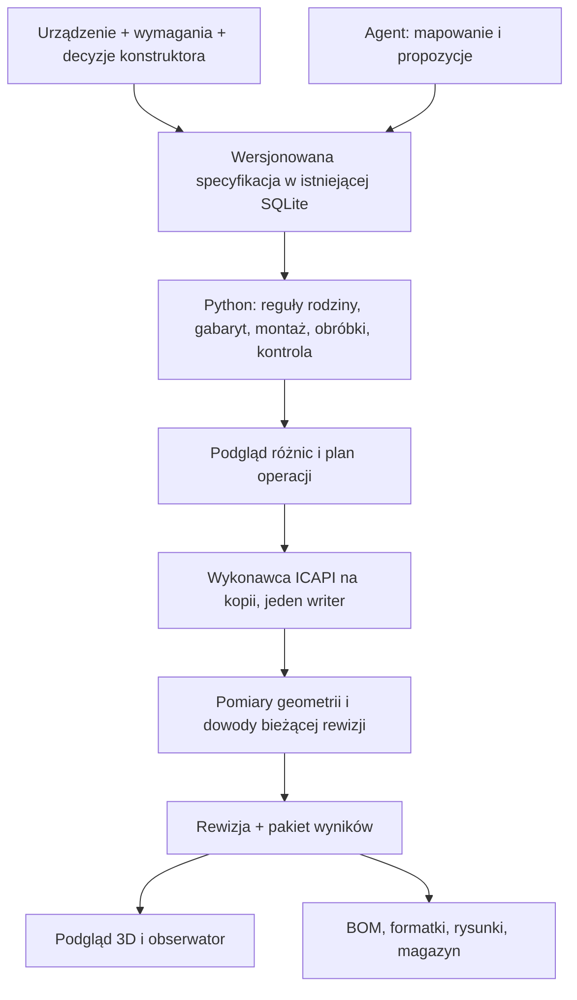

# Architektura RockPro — przegląd i plan rozwoju, 26.10.2026

Największą wartość da teraz połączenie istniejących, sprawdzonych klocków w jeden
przepływ: wersjonowana specyfikacja skrzyni → deterministyczny plan → kontrolowany
wykonawca IronCAD → zmierzony wynik → podgląd i dokumentacja tej samej rewizji.
Python powinien wyliczać konstrukcję, agent pomagać w mapowaniu i wyjątkach, a
konstruktor zatwierdzać brakujące reguły technologiczne. Kolejny uniwersalny
generator obok obecnych modułów zwiększyłby koszt utrzymania.

Przegląd zaczęto na `484bf64`, w gałęzi `codex/t2-parametryzacja`. Obejmuje kod,
kontrakty, dokumentację i odczyt istniejącego eksportu. Nie obejmuje nowego
wykonania CAD, instalacji DLL, prób nośności ani odbioru u klienta. Nowe siedem
rodzin rozwijamy w 2027; odtworzenie w 2023 pozostaje późniejszym etapem. Pytania
konstruktorskie Q01–Q26 są odroczone w ROC-45. Wskazane poniżej braki dotyczą
stanu początkowego przeglądu; równoległe poprawki mają własne raporty i testy.

## Co już jest, a czego jeszcze nie łączy wspólny przepływ

| Obszar | Istniejący kod i rzeczywista granica | Następny krok |
|---|---|---|
| Specyfikacja i obliczenia | `core_case/contracts.py`, `expressions.py`, `planner.py:plan_case`; ograniczony język reguł, jawne jednostki, kontrola manifestu i symetrii | Rodziny otrzymują wersjonowane definicje zdolności, a nie obejście walidatora |
| Ścieżka zapisu i odzyskiwania | `mcp/core_service.py:plan_project_case`, `execute_case_plan`, `recover_case_operation`; wspólna SQLite, CAS i dziennik operacji | Podłączyć rzeczywiste wykonawcze warianty do tej samej historii; obecna podstawowa ścieżka generuje jawne bryły zastępcze |
| Rzeczywiste T1/T2 | `core_case/t1_mounting.py`, `t2_parametric.py:make_recipe`, `scripts/native/T1MachiningPrototype.cs`, `T2ParametricPrototype.cs` | Przypięte prototypy przenieść stopniowo do jawnego interfejsu wykonawcy; zachować ich ograniczenia i testy powrotu |
| Nowe wzorce | `working_mounts.py:build_working_standard` i `plan_component_translation`; źródłowe ramy oraz przesunięcie całego poddrzewa | Mapowanie ról/operacji przed szerszym W/D/H; ruch czapki nie dowodzi parametryzacji wymiarów |
| Wspólne warstwy | `part_registry.py:contract`, `metadata`, `stage_for` | Rejestr prezentacji rozszerzyć o jawny graf zależności w planie, bez udawania, że sam wpis implementuje CAD |
| Wycięcia | `machining_rules.py:machining_step`, `validate_steps`, `local_cut_pose`; właściciel montażu, docelowa część, zmierzony szablon | Uogólnić identyfikatory obróbek i kompletność mapy dla nowych rodzin; bbox nadal nie jest konturem |
| Edycje konstruktora | `native_changes.py:review_handle_update`, `guard_handle_update`, `handle_decision_service.py` | Rozszerzać guard rodzinami z jawnym baseline; aktualna obsługa uchwytów nie chroni dowolnej ręcznej zmiany całej skrzyni |
| Obserwacja | `trace.py:PhaseTrace`, `parts/operation_log.py:OperationLogger`, `NativeSceneBridge.cs:Progress`, `process_observer.py` | Wspólny identyfikator przebiegu oraz zagnieżdżone etapy; realne prototypy T1/T2 nie emitują jeszcze pełnego tego strumienia |
| Podgląd | `prepare_layer_viewer.py:convert`, `layer_viewer.py:make_handler`, Three.js | Jedna niezmienna rewizja modelu i siatki; odświeżanie po rewizji, nie obietnica synchronizacji każdego ruchu w CAD |
| Magazyn/produkcja | `material_service.py`, `inventory_service.py`, `cutting_plan.py`, `purchase_proposals.py`, `material_revisions.py` | Zasilać zatwierdzonym BOM i rzeczywistą technologią; same węzły CAD nie są zakupowym BOM |
| Wydanie | `core_case/release_bundle.py:create_bundle`, `inspect_bundle` | Do istniejącego pakietu dołączyć przypięte rysunki i produkcję, gdy będą dostępne; status draft pozostaje prawdziwy |

Ścieżki bez prefiksu `scripts/` są względem `Integracja/rockpro_cad/`.

## Konkretne ustalenia z przeglądu

**A1 — podgląd mógł zmieniać rewizję podczas jednej sesji. Naprawione w tym przyroście.**
`layer_viewer.make_handler` sprawdzał hash siatki raz, lecz `do_GET` otwierał
`model.json` i `geometry.bin` ponownie dla każdego żądania. Podmiana plików po
starcie pozwalała pokazać nowe, już niesprawdzone dane. Test z podmianą dwóch
poprawnych rewizji odtworzył błąd. Teraz serwer przechowuje i wysyła dokładnie
sprawdzone bajty do końca sesji. Zmiana eksportu wymaga nowej sesji podglądu.
Również zasoby interfejsu są utrwalone w pamięci na czas sesji.

Odczyt ma limit 8 MiB metadanych, 128 MiB geometrii i 8 MiB na zasób statyczny.
Limit dotyczy rzeczywiście czytanych bajtów, więc wzrost pliku między `stat` a
odczytem nie omija ograniczenia. Istniejąca siatka 582 780 trójkątów zajmuje
41 960 160 B; metadane 390 250 B. Kosztem jest pamięć zajęta przez jedną kopię
eksportu. Żądania HTTP współdzielą te same bajty, bez pełnej kopii na klienta.

**A2 — kompletność podglądu i kompletność operacji były mylone. Naprawione.**
W bazowym `process_observer.visible_elements` samo `case.create=passed`
odsłaniało wszystkie elementy, nawet gdy istniał szczegółowy strumień
`native.create` z brakami lub błędami. Komentarz przewidywał użycie zbiorczego
wyniku wyłącznie przy braku szczegółów, ale warunek tego nie wymuszał. Nowy test
rozdziela brak szczegółów, częściowy przebieg i potwierdzone ID.
Naprawę, kolejne znalezione błędy statusów i wyniki opisuje
[raport obserwatora](PROCESS_EVIDENCE_20261026.md).

**A3 — pochodzenie strumienia natywnego wymaga jawnego powiązania.**
Bazowy `process_observer.read_trace` dołączał sąsiedni `native_progress.jsonl`
bez identyfikatora operacji i bez sprawdzenia zgodności z planem. `Progress`
w `NativeSceneBridge.cs` nie emituje `operation_id`; logger Pythona ma własny
UUID, a `process_preview.json` zawiera osobne ID operacji. Sama bliskość plików
nie stanowi kontraktu. Czytnik już oznacza historyczne dane jako niepowiązane;
nie przypisuje im pewności nowego, sprawdzonego powiązania. Rozszerzenie
producenta natywnego śladu pozostaje do implementacji i próby.

**A4 — spójność ram roboczego standardu trzeba sprawdzać przy wejściu do planera.**
Bazowe `working_mounts.py` walidowało sztywność każdej macierzy osobno, ale nie
jej zgodność z hierarchią (`local × parent_world = world`, przy konwencji
wierszowej). Zmieniony później słownik mógł także ominąć część kontroli budowy.
Naprawę walidacji, rebind do bajtów inwentarza i testy ukończył osobny agent:
[raport](MOUNT_STANDARD_REVIEW_20261026.md). Odbicia mają być zachowane;
usuwanie odbicia lub skalowanie bryły w celu „naprawy” macierzy byłoby błędem.

**A5 — rejestr części jest obecnie rejestrem prezentacji.**
`part_registry.py` ma etykiety, paletę i mapę rodzina→etap. To dobre wspólne
źródło dla warstw 01–06, ale nie określa wszystkich zależności konstrukcyjnych,
wykonawców, obróbek i odbiorów. Numery prezentacji nie powinny zostać użyte jako
jedyny scheduler CAD. Przykładowo profile z przerwą na zawias potrzebują pozycji
zawiasu w obliczeniach, choć prezentowane są wcześniej.

**A6 — obecna telemetria nie uzasadnia procentu „samodzielności AI”.**
`OperationLogger._base` ma miejsca na wersje i koszty, ale wiele wartości jest
`null`. `parent_event_id` wskazuje poprzedni wpis łańcucha, nie nadrzędny span.
`PhaseTrace` mierzy fazy, a natywny most podaje zakończone operacje; ich czasy
nakładają się. To wystarcza do odczytu części przebiegu, nie do wiarygodnego
dzielenia całej pracy na skrypty/agent/konstruktor. Nie uzupełniać historii
interwencji na podstawie tego, kto uruchomił skrypt.

**A7 — utrzymanie dwóch hostów wymaga macierzy zdolności, nie tylko roku.**
`icapi_runtime.py` już wymusza wybrany rok, odmawia zmiany wersji w procesie
i sprawdza API hosta. `run_t1_machining_job.py:current_interop` importuje TLB
2023, gdy przykładowy wrapper jest stary. To należy zachować. Zgodność budowy
DLL, otwarcie konkretnego ICS, parametry, obróbki i grafika są osobnymi
zdolnościami. Działający jeden z tych kroków nie potwierdza pozostałych.

## Proponowana ewolucja bez drugiego frameworka

Rozwijamy `core_case` jako jedno miejsce obliczeń, `core_service` jako koordynację
i trwałą historię oraz obecny dodatek jako interfejs i docelowy wykonawca ICAPI.
Istniejące skrypty prototypów pozostają punktami odniesienia, dopóki ich
zachowanie nie zostanie odtworzone i sprawdzone po podłączeniu.

### 1. Rozdzielić rodzinę, asset, wystąpienie i obróbkę

W rozszerzeniu istniejących kontraktów potrzebne są cztery różne tożsamości:

- **Definicja rodziny**: typ konstrukcji, dozwolone parametry i warianty,
  ograniczenia oraz wersja reguł. Rodzina składana z korpusu i zdejmowanej czapki
  nie dziedziczy automatycznie zasad płytkiej pokrywy T1.
- **Asset katalogowy**: producent/SKU, wersja geometrii, rama montażu,
  nominalne dane, status wymaganej obróbki `tak/nie/nieznane`. Połówka zamka
  może należeć do jednego kupowanego zestawu; licznik brył nie ustala zakupu.
- **Wystąpienie**: stabilne ID w projekcie, źródło i CAD path, rola, transformacja,
  właściciel mechaniczny oraz dozwolone ręczne odstępstwo. Hash źródła + path
  identyfikuje referencję; osobne ID projektu identyfikuje wystąpienie.
- **Obróbka**: własne ID, `owner_occurrence_id`, docelowa płyta/profil,
  przypięty szablon konturu, rama, głębokość/przelot i wymagane luzy.
  Jest efektem montażu okucia, nie dodatkową zakupową częścią.

W `contracts.py`, `manifest.py` i `catalog_assets.py` istnieją elementy tego
podziału; należy je rozszerzać, a nie wprowadzać niezależny model tożsamości
w widoku 3D. Surowe nazwy CAD zostają jako informacja, nie klucz semantyczny.
Nieznane dane zatrzymują zależną operację, lecz nie blokują niezależnego odczytu.

### 2. Najpierw cały plan, potem wykonanie w etapach

Planer powinien obliczyć wszystkie zależności przed dodaniem brył. Właściwa
kolejność obliczeń to: gabaryt i światło komory → przekroje/złącza → rozmieszczenie
okuć → strefy zakazane i ruch → przycięcia/wycięcia → lista części → plan CAD.
Etapy 01–06 służą następnie prezentacji wykonania. Koła, podpory i gniazda
pozostają wspólnie w etapie 6.

Graf operacji powinien mieć stabilne ID i jawne poprzedniki. Dodanie uchwytu
tworzy powiązany komplet: pozycję okucia, jego obróbki, kontrolę prześwitu i wpis
BOM. Walidator wykrywa cykle, brak właściciela, podwójny cel oraz nieobsługiwany
typ operacji. Ukrycie uchwytu w gotowym widoku nie cofa otworu. Tryb „budowa
krok po kroku” wymaga geometrii odpowiedniego etapu i musi być odrębny od
filtra widoczności gotowego modelu.

W pierwszym przyroście dopuszczamy tylko operacje znane danemu wykonawcy:
sztywne umieszczenie assetu, zmiana długości potwierdzonego profilu, zmiana
zatwierdzonego konturu płyty i przypięta obróbka. Nie dodajemy dowolnego kodu
ani nazw metod do MCP.

### 3. Parametry i aktualizacja przyrostowa

Każdy parametr potrzebuje stabilnego klucza, polskiej etykiety i komentarza,
jednostki, źródła wymiaru, zakresu, właściciela oraz listy zależnych operacji.
„Wysokość” musi rozróżniać korpus, czapkę, światło komory i pełny gabaryt z
kołami. Nie należy ukrycie zwiększać korpusu po konflikcie okuć.

Najpierw powinna powstać kontrola zależności i porównanie planów. Dopiero potem
można ograniczać regenerację do zmienionych gałęzi. Kryterium cache musi
obejmować parametry, wersję reguł, SHA assetów, kontury i konfigurację hosta.
Cache macierzy lub siatki nie jest nowym dowodem poprawności BRep.

### 4. Wykonawca i zgodność hosta

Docelowy serwis w dodatku wykonuje mały zbiór poleceń na właściwym wątku hosta.
Proces Python planuje i zarządza historią. Obecne prototypy wstrzykują stały
helper przez stary interfejs AddOn — to przydatny dowód, ale nie gotowy publiczny
protokół produkcyjny. Producent zaleca ICAPI dla nowych narzędzi, a rozwój starego
API Add-on zakończył wcześniej: [IronCAD, Using the API](https://www.ironcad.com/support/2023/IRONCAD_Help/Content/Understanding_the_Basics/Using_the_API.htm).

Polecenie powinno przypinać `operation_id`, hash planu, wejściowe rewizje,
SHA źródła/assetów, host PID/API oraz politykę zapisu. Obecny zakaz zapisu CAD
oznacza tryb prototypu w pamięci, a nie ukończony pakiet wydania. Timeout klienta
nie anuluje wykonanego COM; utracona odpowiedź kieruje do odczytu stanu i
odzyskiwania, nigdy do automatycznego powtórzenia montażu.

Named pipes są rozsądnym przyszłym lokalnym transportem, lecz trzeba jawnie
ograniczyć go do właściwego użytkownika i rozmiarów komunikatów oraz zachować
allowlistę poleceń. Sam wybór named pipe nie daje tych gwarancji:
[Microsoft, Named pipes](https://learn.microsoft.com/en-us/dotnet/standard/io/how-to-use-named-pipes-for-network-interprocess-communication).

Macierz zgodności powinna przechowywać host/build, TLB hash, interop hash,
wersję adaptera oraz wyniki osobnych prób: otwarcie źródła, parametry, import
assetu, obróbka, regeneracja, grafika, zapis/otwarcie. Nie instalujemy nowej
wersji dodatku w hoście z niezapisanymi dokumentami.

### 5. Obserwowalność, która wyjaśnia błędy

Rozszerzamy istniejący JSONL i dziennik SQLite o wspólną semantykę; nie tworzymy
drugiej bazy projektów. Na każde wykonanie: `run_id`, `operation_id`, `span_id`,
`parent_span_id`, faza, start/koniec, status, actor wykonawczy oraz osobne
`decision_origin` i `decision_id`. Hash kodu/reguł/wejścia i identyfikatory
assetów wiążą zdarzenie z konkretną rewizją. Treści modeli i ścieżki klienta
pozostają w prywatnych artefaktach, nie w ogólnym logu.

OpenTelemetry opisuje span jako jednostkę pracy z czasem, kontekstem, rodzicem,
zdarzeniami i linkami. Warto przyjąć zgodną semantykę teraz, a opcjonalny eksport
OTLP dodać później: [OpenTelemetry, Traces](https://opentelemetry.io/docs/concepts/signals/traces/).
Istnieje dokumentacja integracji .NET Framework; nie wymaga to przebudowy
dodatku na nowy runtime: [OpenTelemetry, .NET Framework](https://opentelemetry.io/docs/languages/dotnet/netframework/).

Podstawowy ekran powinien pokazywać:

- czas planowania, oczekiwania na writer, przygotowania bridge, wywołań CAD,
  regeneracji, grafiki, eksportu i ewentualnego zapisu osobno;
- czas całego przebiegu bez sumowania rodziców z dziećmi;
- interwencje z przyczyną: brak danych, konflikt konstrukcji, błąd programu,
  ręczne odstępstwo, zmiana wymagania;
- planowane, wykonane i zweryfikowane części jako różne liczniki;
- udział przebiegów bez interwencji dopiero przy znanym mianowniku i pełnym
  zapisie interwencji; historyczne braki pozostają nieznane.

Skrypt napisany dziś przez agenta nadal może być deterministycznym wykonawcą,
ale autor pomysłu/reguły to inny wymiar pochodzenia niż wykonawca skryptu.
Kody błędów muszą wskazywać etap i wystąpienie, aby rozróżnić błąd interpretacji
agenta od błędu transformacji, szablonu albo wykonania CAD.

### 6. Wydajność i baza danych

Najpierw mierzymy konkretny scenariusz: zimny start, kolejna zmiana jednego
parametru, powrót do baseline, eksport podglądu. Liczymy wywołania COM i koszt
regeneracji. Przesyłanie całego planu do wykonawcy wewnątrz hosta oraz jedna
regeneracja na logiczną grupę mają sens jako hipotezy do pomiaru, nie obietnice
przyspieszenia. Pełnych historii cech nie czytamy przy każdym zwykłym montażu.

Do lokalnego profilu Pythona 3.12 pasuje `cProfile`/`pstats`; profil nie zastępuje
benchmarku porównawczego: [Python 3.12, Profilers](https://docs.python.org/3.12/library/profile.html).
Wyniki porównujemy dla tej samej próbki i środowiska; osobno mediana/p95 czasu
CAD oraz czas obliczeń. Nie optymalizujemy na podstawie liczby linii kodu.

`project_store.db()` wykonuje dziś inicjalizację i migracje przy każdym otwarciu
połączenia, także dla wywołań odczytowych. Przy wzroście liczby klientów warto
oddzielić inicjalizację schematu od zwykłego połączenia i utrzymać krótkie
transakcje CAS. Nie ma potrzeby wprowadzać nowej bazy tylko dla panelu.

WAL może pomóc przy równoległych odczytach, ale SQLite nadal ma jednego writera,
a WAL nie działa na sieciowym filesystemie. Decyzja wymaga pomiaru i planu
backupu; nie włączać go w ciemno na zachowanej bazie klienta:
[SQLite, Write-Ahead Logging](https://sqlite.org/wal.html).
Operacja CAD pozostaje poza długą transakcją SQLite.

## Kolejność dalszych przyrostów

| Kolejność | Możliwe bez jutrzejszych odpowiedzi | Konkretny odbiór |
|---|---|---|
| 1 | Poprawki A1–A4 spójności podglądu, logów i standardu | Reprodukcja błędu i test odmowy niespójnych danych; zero zmian źródeł CAD |
| 2 | Raport pokrycia mapowania dla każdego wzorca | Każda część: rola znana/nieznana, obróbka tak/nie/nieznane, brakujący dowód; bez automatycznej promocji |
| 3 | Wersjonowany graf operacji w istniejącym planie | Cykle, sieroty, nieznane operacje i niespójne stage ID odrzucane; okucie i wycięcie współdzielą właściciela |
| 4 | Wspólny trace i raport czasu/ingerencji | Ślad powiązany z planem; nakładające się czasy liczone prawidłowo; nieznane pochodzenie jawne |
| 5 | Macierz zdolności hosta i adaptera | Jawny wybór 2023/2027; brak automatycznego fallbacku; każda zdolność ma własny dowód lub NOT RUN |
| 6 | Reprodukowalny benchmark planera i eksportera | Stałe wejścia/hash, wersja kodu, wynik przed/po; brak CAD w offline benchmarku |

Po ROC-45: mapowanie i ograniczone W/D/H jednej rodziny; następnie powiązane
obróbki oraz progi kolizji, wnętrze/pianki, transport i zgodność piętrowania,
BOM i dokumentacja produkcyjna. Każda rodzina otrzymuje zakres, wzorcowy resize
i powrót, sprawdzenie zachowania sztywnych assetów i odbiór konstruktora.
Wybór pierwszej rodziny pozostaje w Q26; Wing jest propozycją, nie akceptacją.

Stan na koniec tej rundy: poprawki A1–A4 wykonane; generator kart rodzin,
[graf zależności](MACHINING_DEPENDENCY_GRAPH.md), [raport ICAPI](ICAPI_CAPABILITY_REPORT.md)
i [benchmark planera](OFFLINE_MOUNT_BENCHMARK.md) mają kod i testy offline.
Karty pokazują propozycje, nie komplet zatwierdzonych ról każdej części.
Graf nie ma jeszcze adaptera receptur T1/T2 ani wykonawcy natywnego.
Czytnik śladu i raport czasu są poprawione, lecz producent logu CAD nadal nie
dostarcza pełnego powiązania rewizji; liczba interwencji pozostaje nieznana.
Macierz ICAPI potwierdza zapisane sygnatury, nie wykonanie w obu hostach.
Benchmark dotyczy montażu, nie eksportera ani całego procesu budowy CAD.
Te granice nie są zamkniętymi odbiorami wdrożenia.

## Rozszerzenia warte zaplanowania

1. **Wyjaśnianie ograniczeń**: zaznaczenie kolidującego zawiasu i profilu, podanie
   minimalnego wymiaru oraz reguły, która go wymaga. Konstruktor widzi powód
   odmowy zamiast ogólnego „niepoprawny parametr”.
2. **Porównanie rewizji**: zmienione części, obróbki, masa, materiał i koszt
   między wariantami. Nieznana gęstość/cena daje brak wyniku, nie zero.
3. **Instrukcja montażu z modelu**: etapy, orientacje okuć, karta kontroli i
   oznaczenia formatek; bazuje na tym samym grafie i identyfikatorach.
4. **Tryb konstruktora**: blokowanie ręcznie ustawionej części i jawny konflikt
   z nową regułą; wybór zachowania poprawki lub powrotu do generatora.
5. **Karta źródła urządzenia**: wersja dokumentacji, wymiary, strefy wrażliwe,
   pozycja transportowa, wymagany dostęp i kto to potwierdził.
6. **Biblioteka modułów**: rack, szuflada, pianka, teleskop, stopki, transport
   bagażowy. Każdy moduł ma osobny kontrakt; włączenie modułu nie zgaduje jego
   przeznaczenia w historycznej konstrukcji.
7. **Przebieg otwierania/wyjmowania**: ruch sztywnych komponentów po potwierdzonej
   osi lub kierunku z kontrolą obszaru ruchu. Animacja prezentacyjna i dowód
   mechaniczny muszą mieć różne statusy.
8. **Pakiet dla produkcji i serwisu**: rewizja, formatki, obróbki, lista zakupowa,
   status braków i identyfikator etykiety/QR; format maszyn zależy od Q07.

## Weryfikacja tego przyrostu

- PASS: błąd podmiany rewizji viewera odtworzony przed naprawą.
- PASS: 3 nowe testy `mcp/test_layer_revision.py` — niezmienność sesji po
  podmianie/usunięciu plików, błędny kontrakt/hash i granice wielkości.
- PASS: istniejący test allowlisty HTTP
  `test_process_observer.StageGroupingTests.test_layer_server_only_serves_allowlisted_files`.
- PASS: odczyt rzeczywistego eksportu 41 960 160 B, utworzenie handlera,
  identyczne SHA plików przed/po. Pojedynczy pomiar ładowania około 79 ms jest
  obserwacją tej próby, nie benchmarkiem ani obietnicą przyspieszenia.
- NOT RUN: CAD, zapis/otwarcie ICS, instalacja, nowa wizualna akceptacja sceny.
- Dowody lokalne: `artifacts/night-research-20261026/architecture-viewer-tests.json`
  i `architecture-viewer-dataset.json`. Test HTTP wymagał dostępu loopback poza
  sandboxem; pierwotna odmowa WinError 10013 nie była błędem aplikacji.

Źródła sieciowe powyżej odczytano 26.10.2026. Dodatkowe ograniczenie utrzymania:
IronCAD liczy wyrażenia w metrach/radianach/kilogramach, nawet gdy tabela pokazuje
inne jednostki ([IronCAD, Expressions](https://www.ironcad.com/support/2023/IRONCAD_Help/Content/3D_Design_Environment/Assembly_Part_Operations/Expressions.htm));
WinForms wymaga dostępu do kontrolek z ich wątku, a `InvokeAsync` z nowych .NET
nie jest dostępne w .NET Framework ([Microsoft, thread-safe calls](https://learn.microsoft.com/en-us/dotnet/desktop/winforms/controls/how-to-make-thread-safe-calls)).
Zalecenia architektoniczne są oceną tego repozytorium, nie deklaracją producentów,
że cały proponowany przepływ został już wdrożony.
