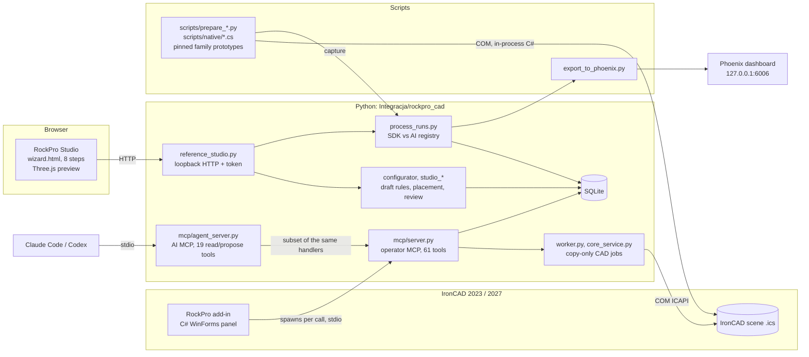

# RockPro CAD — an introduction for newcomers

*Written 12 November 2026 from a full read of the repository (branch
`review/observability-audit`, on top of `main` at `cafa890`). It describes what the code
does **today**, not what the plans promise. Where the two differ, this document says so.*

> **How to read this.** Part 1 explains the business and the vocabulary. Part 2 shows the
> whole system on one page. Part 3 tours each component. Part 4 lists the rules you must
> not break. Part 5 is the folder map. Part 6 is the honest status. Part 7 is a learning
> path with small exercises. The glossary at the end translates the Polish terms you will
> meet everywhere in code, UI and docs.

---

## Contents

1. [The problem we are solving](#1-the-problem-we-are-solving)
2. [The system on one page](#2-the-system-on-one-page)
3. [Component tour](#3-component-tour)
   - 3.1 [RockPro Studio (browser configurator)](#31-rockpro-studio--the-browser-configurator)
   - 3.2 [The parts library](#32-the-parts-library)
   - 3.3 [The IronCAD add-in and the operator MCP server](#33-the-ironcad-add-in-and-the-operator-mcp-server)
   - 3.4 [`core_case`: contracts, planner and the CAD journal](#34-core_case-contracts-planner-and-the-cad-journal)
   - 3.5 [Native family prototypes (the real CAD work)](#35-native-family-prototypes--the-real-cad-work)
   - 3.6 [Business modules: layout, devices, Excel, BOM, stock](#36-business-modules-layout-devices-excel-bom-stock)
   - 3.7 [Observability: who did what — script or AI](#37-observability-who-did-what--script-or-ai)
   - 3.8 [AI agents](#38-ai-agents)
4. [The golden rules](#4-the-golden-rules)
5. [Repository map](#5-repository-map)
6. [Where things really stand](#6-where-things-really-stand-12-november-2026)
7. [Learning path and exercises](#7-learning-path-and-exercises)
8. [Common confusions (FAQ)](#8-common-confusions-faq)
9. [Glossary](#9-glossary)

---

## 1. The problem we are solving

### 1.1 The business in one paragraph

RockPro builds **transport cases** (*skrzynie transportowe*, often called flight cases or
road cases) for stage, AV and event equipment: projectors, TVs, mixing consoles, racks of
19-inch gear, lighting, drawer workstations. Each case is made to fit the customer's
device: a box of **plywood** (*sklejka*) panels joined by **aluminium edge profiles**,
with steel **corners**, **hinges**, **latches**, **handles**, and often **castors** with
matching **stacking sockets** so that cases can sit on each other.

Today a design engineer (*konstruktor*) models each case by hand in **IronCAD 2023**, a 3D
CAD program, on one shared company computer that people reach over Remote Desktop (RDP).
That is slow and repetitive. Most cases are variations of a few **families** (a chest with
a hinged lid, a cabinet with a front door, a TV case with a removable cap, a rack…).

### 1.2 What this project wants to become

A pipeline from *"customer needs a case for device X"* to *"a checked IronCAD model plus a
bill of materials in the company Excel"*:

```text
 customer request ─► configure the case ─► place hardware ─► check the draft
        │                (browser)            (browser)          (rules)
        ▼
 IronCAD model on a NEW copy ─► measure, save, reopen ─► snapshot ─► BOM ─► company Excel
     (scripts drive the CAD API)                                       (not built yet)
```

The guiding idea, repeated across the docs: **calculations are done by deterministic
scripts; AI helps with proposals and exceptions, through the same operations, and never
silently.** The full target is an 11-step process
([CUSTOM_CASE_WORKFLOW.md](CUSTOM_CASE_WORKFLOW.md)). Only part of it exists today (see
[section 6](#6-where-things-really-stand-12-november-2026)).

### 1.3 Anatomy of a case: learn these words first

```text
              lid (wieko / pokrywa)  ◄── 10–15 % of body height by default
           ┌──────────────────────────┐
  hinge ─► ╞══════════════════════════╡ ◄── latch (zamek/zatrzask) on the joint line
 (zawias)  │                          │
           │   body (korpus)          │ ◄── handle (uchwyt), usually 2 per side,
  profile ─┤   plywood panels         │     on the two walls perpendicular to the
 (profil)  │   colour #408080 (green) │     hinge wall
           │                          │
  corner ─►└──────────────────────────┘
 (narożnik)   ●                    ●   ◄── castors (koła) + bottom supports;
                                           matching stacking sockets (gniazda) on top
```

- **Section** (*sekcja*): a piece of the box that opens or comes off, such as the body, a
  lid or a front.
- **Joint / seam** (*złącze*): where two sections meet. Hinges and latches belong to
  joints, never to arbitrary points on a wall.
- **Internal dimensions** (*wnętrze*): the space the device needs. RockPro's XYZ always
  means the inside of the body, not the outside of the whole case.
- **Cutout / machining** (*wycięcie / obróbka*): a hole in plywood or a notch in a profile
  needed to mount a piece of hardware. A cutout belongs to its hardware item and moves with
  it ("shared anchor").
- **SKU**: a catalogue part code, for example `H7159` (handle), `17251S` (latch), `270836`
  (hinge), `410429` (corner), `EG-0113` (profile). Catalogue parts are **rigid**: we move
  them and never resize them.

### 1.4 The tools you will hear about

| Tool | What it is | Why it matters here |
|---|---|---|
| **IronCAD** | Windows 3D CAD program. Files are `.ics` "scenes". A scene can hold named **parameters** that drive feature sizes. | It is the target. The company uses **2023 (API 25.0)**. Most of our prototypes were made in **2027 (29.0)**, and **2027 files do not open in 2023**. |
| **ICAPI** | IronCAD's COM automation API, used from C# or Python (`comtypes`). | Every CAD change goes through it. COM is fragile: one writer at a time, on one thread. |
| **Add-in** | A DLL that IronCAD loads at start-up and that shows a RockPro panel inside IronCAD. | Our add-in is C#/WinForms (.NET Framework 4), registered per user in HKCU. |
| **MCP** | Model Context Protocol: JSON-RPC over stdin/stdout. Originally for AI tools. | We use it as the *one* API both the add-in and AI clients call. No HTTP port. |
| **SQLite** | A file database. | One shared database holds projects, drafts, layouts, plans and the process registry. |
| **Three.js** | A WebGL 3D library. | Draws the browser Studio's 3D preview. |
| **Arize Phoenix** | A local tracing dashboard. | Shows which steps were done by scripts and which were decided by AI ([OBSERVABILITY_HOWTO.md](OBSERVABILITY_HOWTO.md)). |
| **Linear** | Issue tracker; tickets are `ROC-<n>`. | Docs and code cite ROC numbers. Linear needs a separate invite. |

---

## 2. The system on one page

There are **two user-facing applications**, plus **scripts that do the real CAD
work**. They all share one SQLite database and a few Python modules.



Read the diagram as three loosely connected stories:

1. **Concept design (works, no CAD needed).** A person uses **Studio** in a browser to
   pick a case type, size it, choose hardware from the library and place it. Drafts are
   saved with revisions in SQLite. Nothing touches IronCAD.
2. **CAD execution (narrow).** The **add-in** inside IronCAD calls the **operator MCP
   server**, which can change six parameters of one known 10-panel demo skeleton on a
   copy. Separately, per-family **scripts** (`prepare_*.py` + `native/*.cs`) build much
   richer parametric prototypes, but each is pinned to one source model.
3. **Evidence.** Every job can record what happened, who decided it (standard script, AI,
   manual) and who executed it (SDK, Python, agent, constructor) in a **process
   registry**. An exporter sends finished runs to **Phoenix**.

**The missing bridge:** there is no generic "Studio draft → complete IronCAD model"
button yet. Studio drafts and the CAD prototypes are separate tracks today.

---

## 3. Component tour

Paths without a leading folder are relative to `Integracja/rockpro_cad/`.

### 3.1 RockPro Studio — the browser configurator

**What it is.** A local web app: `reference_studio.py` (a ~270-line HTTP server built on
the Python standard library, *not* FastAPI) serves static files from `reference_studio/`
(plain JS modules + Three.js r180 in `viewer3d/vendor/`).

**Security model** (worth understanding before you add a route):
- It listens on `127.0.0.1` only, on a random port unless you pass `--port`.
- Every URL starts with a random **session token**: `http://127.0.0.1:<port>/<token>/`.
- POST requests also need the `X-RockPro-Session` header and a matching `Origin`. A strict
  Content-Security-Policy is set.
- Only an explicit allowlist of POST endpoints exists: `validate`, `wizard/preview`,
  `wizard/review`, `wizard/save`, `wizard/convert`, `parts/preferences`, `process`.

**Two screens.**
- **Gallery** (`index.html`, `app.js`, `reference3d.js`): seven real reference models in
  six groups, loaded from private preview datasets (`model.json` + `geometry.bin`, checked
  against SHA-256 hashes before serving). It is used to look, compare and move assemblies.
- **Wizard** (`wizard.html`, `wizard.js`, `wizard3d.js` …): the configurator, with 8 steps:

| Step | Name in UI | What happens | Code |
|---|---|---|---|
| 1 | Typ konstrukcji | Choose exactly one of three types: **Skrzynia** (case, one top lid), **Szafa** (cabinet, one front), **Skrzynia 3-elementowa** (body + removable front + removable top) | `configurator.TYPES` |
| 2 | Wieka i współpraca | Hinged or removable; hinge edge; how covers cooperate (independent / together / sequence / custom order, with cycle detection) | `configurator.validate` |
| 3 | Wymiary sekcji | Internal size (50–10000 mm), plywood thickness (3–30 mm), cover depth; a hinged top lid over 15 % of body height needs an explicit "constructor override" | `configurator.preview` |
| 4 | Części i okucia | Pick hardware *types* from the library (catalogue, supplier 3D models, company Excel records) | `studio_parts.py`, `parts-picker.js` |
| 5 | Uchwyty i ścianki | Drag and drop handles onto walls: 1–16 per wall, symmetry, rows | `studio_placement.py`, `placement-editor.js`, `placement3d.js` |
| 6 | Zatrzaski i zawiasy | Latches and hinges on the actual seams between sections, evenly spaced, avoiding handles | `studio_closures.py`, `studio_joints.py`, `closure-editor.js` |
| 7 | Konstrukcja i podstawa | Profiles, corners, braces, castors with paired stacking sockets (case type only) | `studio_structure.py`, `structure3d.js` |
| 8 | Kontrola projektu | Review: errors / warnings / info, each linking back to the step and group to fix | `studio_review.py`, `review-panel.js` |

**The draft format** is JSON with `schema: "rockpro.configurator/3"`. Older v1/v2 drafts are
never rewritten; `wizard/convert` makes a *new* v3 draft. Saving uses **optimistic
concurrency**: you send `expected_revision`; if someone saved in between, you get HTTP 409
and must reload. Drafts and every saved version (with SHA-256) live in the SQLite tables
`configurator_drafts` and `configurator_draft_versions`.

**What Studio deliberately does not do:** no CAD file, no cutouts, no real joint gaps.
`preview()` returns `cad_ready: False`, and panel sizes are `nominal_not_cutting`. Joint
gap and plywood trim are `None`: they will come from the chosen hardware's mounting
template, which is not connected yet. The review is labelled
`collision_scope: known_2d_envelopes_same_wall` and `production_approved: False`.

**Online demo.** A static build (`scripts/build_vercel_studio.py`, `deploy/vercel/`) is
published at <https://rockpro-studio.vercel.app> for the client. Drafts there are saved
*in the browser only*. There is no shared database and no IronCAD, and pushing to Git does
not update it ([STUDIO_VERCEL.md](STUDIO_VERCEL.md)).

### 3.2 The parts library

Hardware data comes from several sources that are deliberately kept apart:

| Source | Location | What it gives | What it does *not* give |
|---|---|---|---|
| Reference hardware | `docs/catalog/hardware-reference.json` → `studio_parts.py` | 12 base definitions (H7159, H2026, 17251S, 270836, 2643, EG-0113, EG-0500/1, EG-0500/2, 410429, B1930, B1121, W0968Z) with families | approved mounting |
| Company catalogue | `artifacts/erp-company-parts/catalog.json` (private snapshot of the company Excel) → `company_catalog.py` | 265 records with prices and photos | live stock, CAD models |
| Supplier 3D models | `assets/supplier-parts/` (tracked) → `supplier_parts.py` | Penn Elcom meshes and thumbnails for 81 variant definitions | cutout or mounting approval |
| Manufacturer photos | `manufacturer_images.py` | product photos matched to the full SKU | geometry |
| Source parts | `source_parts.py` | candidates extracted from existing customer models | confirmed function |
| Favourites | `part_preferences.py` | stars and "used in N different projects" | anything about stock |

Every part belongs to a **family** (handles, hinges, latches, profiles, corners, braces,
wheels, stacking_sockets…). Each family maps to one of **six assembly stages** with fixed
colours (`part_registry.py`): plywood → aluminium profiles → corners and braces → locks
and hinges → handles → wheels and stacking sockets. CAD scenes, the observer and Studio use
the same stages ([CASE_STRUCTURE.md](CASE_STRUCTURE.md)).

> A mesh that looks right is **not** proof that the part can be mounted. Accepting a new
> SKU is a pipeline: preserved source → inventory → extract the assembly → mesh/thumbnail
> → mounting frames and cutouts → test on a copy. Missing data is `unknown`, never "no
> cutout needed".

### 3.3 The IronCAD add-in and the operator MCP server

This is the oldest track (MVP 0.3/0.4) and the only one that runs *inside* IronCAD.

**The add-in** (`addin/`, about 2000 lines of C#):
- `RockProAddin.cs` registers COM classes `RockPro.CAD.Addin2023` and `RockPro.CAD.Addin`
  with IronCAD (per-user HKCU, via `Install-User.ps1` / `Setup.ps1 -InstallAddin`).
- `RockProPanel.cs` is the panel: project cards, 9 manual workflow stages, snapshots.
- Forms: `LayoutForm` (device layout), `CasePlanForm`, `DeviceVariantsForm`,
  `HandleDecisionForm`, `InventoryForm`, `InventoryCommandForm`, `MaterialPlanForm`,
  `PurchaseProposalForm`. All UI text is Polish with English fallbacks (`UiText.T`).
- **How it talks to Python:** for *every* tool call, `Rpc.Call` starts
  `Integracja/.venv/Scripts/python.exe mcp/server.py`, performs the MCP `initialize`
  handshake, sends one `tools/call`, reads the reply and exits. There is no long-running
  service and no C# database.

**The operator MCP server** (`mcp/server.py` → `mcp/worker.py`) exposes **61 tools**.
They fall into groups:

| Group | Example tools | Backed by |
|---|---|---|
| Demo skeleton CAD | `inspect_project`, `change_dimensions_on_copy`, `create_snapshot` | `worker.py`, `ironcad_adapter.py` |
| Projects and stages | `list_projects`, `save_project`, `set_stage`, `get_history` | `project_store.py` |
| Device layout | `preview_layout`, `save_layout`, `preview_device_layouts` | `layout.py`, `layout_variants.py` |
| Case planning and execution | `preview_case`, `plan_project_case`, `execute_case_plan`, `recover_case_operation` | `core_service.py`, `core_case/` |
| Devices and families | `save_device_record`, `recommend_case_families` | `device_catalog.py`, `family_recommendation.py` |
| Excel and BOM input | `preview_excel_configuration`, `import_bom_file` | `excel_input.py`, `material_service.py` |
| Cutting plans | `verify_cut_plan`, `solve_reference_cut_plan` | `cutting_plan.py` |
| Stock, purchases, material plans | `inventory_command`, `preview_purchases`, `save_material_plan` | `inventory_*.py`, `purchase_proposals.py`, `material_revisions.py` |
| Handle reconciliation | `measure_handle_reconciliation`, `save_handle_reconciliation` | `handle_decision_service.py` |

**The demo skeleton** is the one model the generic worker can change:
`Integracja/skeleton/demo/RockPro_Epson_szkielet_MVP.ics`. It is not in Git and comes
through a separate channel. It has 10 plywood plates in two halves (base and lid) and six
scene parameters, all in mm:

```text
RP_Length  RP_Depth  RP_BaseHeight  RP_LidHeight  RP_Thickness  RP_DisplayGap
```

`change_dimensions_on_copy` checks the request against that allowlist and its limits,
then:
1. makes a copy;
2. changes the parameters on the copy;
3. measures every plate against the manifest;
4. saves, reopens and measures again;
5. archives a `snapshot.ics` with its SHA-256 and checks that the original is untouched.

Workflow stages (`inquiry … production`) are **manual records**. Setting "approved" does
not validate anything in CAD.

### 3.4 `core_case`: contracts, planner and the CAD journal

`core_case/` is the **pure-Python heart** for full-case design. Most of it has no CAD
imports:

- `contracts.py`: strict versioned JSON contracts (`CaseSpec v1`, manifests, recipes).
  Unknown fields are rejected ([CASE_CONTRACT.md](CASE_CONTRACT.md)).
- `expressions.py`: a tiny safe recipe language. No Python `eval`, ever.
- `planner.py`: `plan_case(request)` turns a spec and recipe into a deterministic plan:
  positions, frames, rotations, pairing, symmetry and inventory accounting. Today it only
  supports the **synthetic** recipe `synthetic-roc43-rules-v1` (37 groups, 67 occurrences
  by default). A bad recipe gives `blocked` with diagnostics and `changes=[]`.
- `manifest.py`: read-only inventory of a source model. An inventory *draft* is never an
  executable template (`MANIFEST_NOT_READY`).
- Hardware proofs of concept, each pinned to a measured source: `hardware_poc*.py`
  (H7159 handle), `latch_*.py` (17251S latch), `hinge_placement.py` (270836),
  `corner_*.py` (410429), `wheels_sockets.py`, `profile_rules.py`,
  `transport_rules.py`, `t1_mounting.py`, `t2_family.py`.

`mcp/core_service.py` wraps the planner with the shared database and a **durable
operation journal**:

```text
planned → applying → saved → reopened_verified → registered
                 ↘ failed            ↘ outcome_unknown (exception / lost reply)
```

An unfinished operation blocks new CAD work on that project. **Recovery only re-reads
evidence and never re-runs CAD.** This matters because a half-finished COM job could
otherwise insert parts twice. The generic executor builds **placeholder solids**, not real
catalogue hardware; snapshots are registered as `validation="prototype"`,
`production_approved=false`. Details: [CORE_RUNTIME.md](CORE_RUNTIME.md).

### 3.5 Native family prototypes — the real CAD work

The impressive parametric models were **not** made by the generic executor. Each was made
by a **source-pinned script pair**:

- `scripts/prepare_<family>.py` reads a private, SHA-checked inventory of one specific
  customer model and writes a plan.
- `scripts/native/<Family>2027.cs` is compiled and run against IronCAD. On a **new copy**
  it creates scene parameters, binds features to them, adds machining, writes Polish
  descriptions and checks resizing, save and reopen.

| Family | Scripts | State (from the docs) |
|---|---|---|
| T1 / projector case (Epson) | `prototype_t1_machining.py`, `T1MachiningPrototype.cs`, `RepairT1Mounting2023.cs` | Historic. The original T1 source fails in 2023 ("Shape Load Failed") |
| T2 (cap, flap, rack) | `t2_family.py`, analysis docs | Read and save/reopen PASS in 2023; parametrisation incomplete |
| TV (Hisense) | `prepare_tv_*.py`, `*Television*2027.cs` | 34 scene parameters, 56 bound machining operations; current R005 needs a re-test |
| Wing Compact (mixer, high cap) | `prepare_wing_compact.py`, `WingCompact2027.cs` | 2027 prototype |
| Chest (*kufer*) | `prepare_kufer.py`, `Kufer2027.cs` | 29 controls, 356 parts; 2027 prototype |
| 9U rack | `prepare_rack.py` | 2027 prototype; 19-inch rails stay rigid |
| Drawer workstation | `prepare_drawers.py` | 2027 prototype |
| Requested Penn/Adam Hall case | `prepare_requested_native_case.py`, `RequestedCase2027.cs` | 2027 review prototype |

**Important:** all six parametrised family models were saved in IronCAD 2027
(`*_IC2027.ics`) and **cannot be opened in 2023**, the version the client uses. They must be
rebuilt in 2023 (audit finding O10). The only end-to-end proof in 2023 today is a small
diagnostic part made by `scripts/run_2023_parametric_job.py`
([OBSERVABILITY_HOWTO.md](OBSERVABILITY_HOWTO.md)).

Shared native plumbing:
- `icapi_runtime.py` makes you **choose the host year explicitly**
  (`ROCKPRO_IRONCAD_YEAR=2023`) and never falls back to the newest installed version.
- `cad_lock.py` ensures **one CAD writer** at a time across all checkouts, using the
  Windows mutex `Local\RockProCAD.NativeWriter.v1` plus legacy lock files.
- `addin/Repair-IcApi.py` re-registers the API type library for the current user. You need
  it after uninstalling another IronCAD version leaves stale registrations behind.

### 3.6 Business modules: layout, devices, Excel, BOM, stock

These are offline services in `mcp/`, reachable through the operator MCP server and partly
through WinForms forms. They are implemented and unit-tested but **not yet connected to
the company's real Excel**.

- **Layout** (`layout.py`, [LAYOUT.md](../LAYOUT.md)): fit 1–30 identical devices in a
  box. It tries 6 orientations × 3 directions, ranks them by outer volume, and adds
  partitions and a side compartment.
- **Device catalogue** (`device_catalog.py`): source-cited device dimensions. Missing or
  conflicting facts stay unresolved, and `draft_device_inquiry` writes the question but
  never sends it.
- **Family recommendation** (`family_recommendation.py`): filters families by capability,
  with reasons.
- **Excel input** (`excel_input.py`, `examples/excel-input/`): bounded XLSX import with
  explicit units.
- **Cutting BOM, cutting plans, stock, purchases, material plans** (ROC-29…33):
  transactional stock lots with reservations and returns, guillotine cut-plan
  verification, purchase *proposals* that never order, and immutable material plans with
  staleness checks.

The design rule for Excel: it remains the company's record. RockPro will export controlled
data and must never overwrite manual decisions or formulas
([EXCEL_ERP_INTEGRATION.md](EXCEL_ERP_INTEGRATION.md)).

### 3.7 Observability: who did what — script or AI

The client wants to see how much of a job is automation (SDK/Python scripts) and how much
needed an AI decision. Here is how that is recorded:

- **`process_runs.py`**: a run is bound to one Studio draft *revision and SHA*. Events are
  `span` (a whole job), `operation` (a leaf step), or `intervention` (a decision with a
  reason). Each event has two independent labels:
  - `origin`: who decided it (`standard`, `ai`, `manual`, `unknown`);
  - `executor`: who carried it out (`sdk`, `python`, `agent`, `constructor`, `unknown`).

  An AI decision carried out by the SDK is **one** operation (`origin=ai, executor=sdk`),
  not two. An AI operation must link to a recorded intervention. A run cannot be closed
  as `completed` while anything failed or is still open.
- **`process_capture.capture()`** wraps a CAD job and imports its `native_progress.jsonl`.
  Bookkeeping errors never change the job's own result.
- **`scripts/studio_process_run.py`** is the CLI: `start`, `decide`, `finish`.
- **Viewers:** the Studio process panel (`process-panel.js`), a Tk desktop observer
  (`process_observer.py`, `scripts/Observe.ps1`), and **Phoenix**
  (`phoenix_export.py`, `scripts/export_to_phoenix.py`, `scripts/Start-Phoenix.ps1`).

The step-by-step guide is [OBSERVABILITY_HOWTO.md](OBSERVABILITY_HOWTO.md). Open questions
about how to count the AI share and how to link agent sessions to runs are in
[OBSERVABILITY_AUDIT_20261110.md](OBSERVABILITY_AUDIT_20261110.md) (O1, O2).

### 3.8 AI agents

An AI client (Claude Code, OpenAI Codex) connects to **`mcp/agent_server.py`**, not to the
operator server:

- It gets an **allowlist of 19 read/propose tools** (`preview_case`,
  `recommend_case_families`, `get_layout`, `get_project`, `list_snapshots`, …). It cannot
  save, set stages, run CAD or run shell commands *through RockPro*.
- Each session has budgets (by default 30 tool calls, 120 s, 2 retries). Every call is
  logged to `artifacts/agent-runs/<session>.jsonl`. The log keeps the tool name, status,
  duration, argument *hash* and the client name, never the arguments or results.
- The add-in keeps using the full `server.py`. AI is optional everywhere; nothing in the
  pipeline requires an API key.

Caveat for the shared RDP computer: the allowlist does **not** limit the client's own
built-in file and shell tools. Keeping agents away from private files is a client
configuration and Windows permissions matter ([AGENT_SETUP.md](AGENT_SETUP.md) and the admin
section of [OBSERVABILITY_HOWTO.md](OBSERVABILITY_HOWTO.md)).

---

## 4. The golden rules

These come from [AGENTS.md](../AGENTS.md), [DEVELOPMENT.md](DEVELOPMENT.md) and explicit
client decisions. Reviews reject changes that break them.

1. **CAD changes only on a new copy.** Never edit, save or close the user's originals or
   unknown open documents. Close only documents your operation opened.
2. **One CAD writer at a time** (`cad_lock.py`). COM calls stay on the calling STA thread;
   never call COM from an HTTP handler thread.
3. **Do not parametrise hardware *counts* in IronCAD** (client decision of 31.10.2026).
   No `*_Liczba` fields, no count-driven patterns, no auto-adding or removing of handles,
   hinges or latches when dimensions change. Parametrise dimensions, positions, spacing,
   wall/section and the related cutouts instead. If the chosen set does not fit, report a
   conflict and leave the count alone. Older R003–R005 descriptions are history.
4. **Never scale a catalogue part (SKU).** Hardware is rigid; a hardware item, its cutout
   and its profile break share one anchor.
5. **Unknown is not zero.** Missing price, quantity, cutout or dimension stays empty with a
   reason. "Unknown cutout data" is not "no cutout needed".
6. **IDs are logic, labels are for people.** Every occurrence gets a Polish description
   such as "Uchwyt H7159 — korpus — przód — lewy" (handle — body — front — left), but code
   uses stable IDs and SKUs. Wall sides are fixed in the project frame, not relative to the
   camera.
7. **Optimistic concurrency everywhere.** Writes carry `expected_revision`. On conflict,
   show both versions; never refresh the token and retry automatically.
8. **No arbitrary execution in MCP tools.** No `exec`, `eval` or shell tools; recipes use
   the inert expression language.
9. **One source of truth.** Shared SQLite through the same service functions; no second
   database in C# or the browser.
10. **Report honestly: PASS / FAIL / NOT RUN.** Keep apart: implemented code, unit test,
    native CAD test, and mock-up without backend. Offline tests never prove CAD. A build
    does not mean the running IronCAD loaded the new DLL. A manual stage status never
    pretends to be validation.
11. **Do not commit private data:** `.venv`, customer models, SQLite files, logs,
    revisions, local configs, vendor SDK/DLLs. These live in `artifacts/` or elsewhere and
    are exchanged through separate packages.
12. **IronCAD version matters.** The target is 2023. Files saved in 2027 do not open in
    2023, and metadata saying "2023" does not prove a file opens.

---

## 5. Repository map

About 540 tracked files outside `legacy/` and `assets/`.

```text
RockPro/
├─ README.md, HANDOVER.md, AGENTS.md, LAYOUT.md   Polish entry docs and agent rules
├─ Setup.ps1, configure.py, requirements.txt       install: venv, deps, paths, add-in build
├─ Integracja/                                     the application ("integration")
│  ├─ ironcad_adapter.py, review_skeleton_*.py     attach-only COM adapter, skeleton audits
│  └─ rockpro_cad/
│     ├─ reference_studio.py + reference_studio/   Studio server + browser UI
│     ├─ configurator.py, studio_*.py              draft rules, placement, closures, review
│     ├─ family_concepts.py                        reference gallery catalogue
│     ├─ studio_parts.py, company_catalog.py,      parts library sources
│     │  supplier_parts.py, source_parts.py, part_*.py
│     ├─ process_runs.py, process_capture.py,      SDK/AI registry, collector, Tk observer,
│     │  process_observer.py, phoenix_export.py    Phoenix mapping
│     ├─ cad_lock.py, icapi_runtime.py             one writer; explicit host year
│     ├─ mcp/                                      server.py (operator), agent_server.py (AI),
│     │                                            worker.py, project_store.py + services
│     ├─ core_case/                                contracts, planner, hardware POCs
│     ├─ parts/                                    read-only scene inventory reader
│     ├─ addin/                                    C# WinForms add-in, Build.ps1, Install-User.ps1
│     ├─ qa/                                       acceptance tests and fixtures
│     └─ viewer3d/vendor/                          pinned Three.js
├─ scripts/                                        CLIs: Verify, prepare_*, run_*, prove_*,
│  └─ native/*.cs                                  compiled C# CAD adapters (mostly 2027)
├─ docs/                                           ~100 topic docs (mostly Polish)
│  └─ catalog/hardware-reference.json              base hardware definitions
├─ assets/supplier-parts/                          portable Penn Elcom meshes + thumbnails
├─ tests/core_design/                              ROC-43 frozen planner requirements + oracle
├─ examples/excel-input/                           valid / boundary / invalid XLSX samples
├─ deploy/vercel/                                  static demo extras
├─ tools/phoenix/                                  pinned Phoenix requirements (venv ignored)
├─ tools/workspace/                                helper scripts + CODE_INVENTORY.json
├─ legacy/local-code/                              ARCHIVE ONLY — never import or run in bulk
├─ .agents/skills/                                 repo skills: scope-check, verification
├─ .github/                                        Copilot instructions and prompts
└─ artifacts/   (git-ignored)                      private data, evidence, databases, jobs
```

What is **not** in a fresh clone: customer `.ics` models (including the demo skeleton), the
preview datasets (`model-library-20261026`, `family-3d-20261027`), the company catalogue
snapshot, evidence reports and databases. They come as SHA-checked handover packages
([KUBA_HANDOVER.md](KUBA_HANDOVER.md), [HANDOVER_PACKAGES.json](HANDOVER_PACKAGES.json)) and
are unpacked into `artifacts/`. If something is missing, report it as missing data; never
replace it with a fake.

---

## 6. Where things really stand (12 November 2026)

| Area | State |
|---|---|
| Studio steps 1–8, drafts, revisions, JSON, review | **Works** locally (SQLite) and as a browser-only demo on Vercel |
| Parts library, supplier meshes, favourites, partial pricing | **Works** for presentation; mounting not approved |
| Process registry + Phoenix dashboard | **Works**; tested end to end in IronCAD 2023 on 10.11.2026 |
| Operator add-in with 6-parameter skeleton | Works in 2027 historically; **2023 build PASS**; panel click in 2023 **NOT RUN** |
| Generic case planner + journal | **Works offline** with a synthetic recipe and placeholder solids |
| Family parametric prototypes (TV, Wing, chest, rack, drawers) | Exist, **saved in 2027 only**; must be rebuilt in 2023 |
| T1 (projector) in 2023 | **Blocked**: source fails to load ("Shape Load Failed") |
| Studio draft → complete verified ICS | **Not built**; the central missing piece |
| Cutouts, joint gaps, profile breaks from chosen hardware | **Not built** (needs mounting templates per SKU) |
| BOM to company Excel | **Not built**; waiting for the real workbook's structure |
| AI decision linked automatically to a run | **Not built** (audit O2) |

The next steps agreed in the docs, in order: environment and tests → **one complete family
in 2023** → confirmed mounting and machining → bind a Studio revision to that family's
adapter → CAD test on a copy → registry/review → constructor acceptance. After that come
more families, then ERP.

Roles: the client's design engineer defines requirements and accepts designs. Marcin owns
requirements and implementation. Kuba (with AI help) does adversarial review, tests,
bugfixes and observability.

---

## 7. Learning path and exercises

### Day 1: understand without running CAD

1. Read this document, then [README.md](../README.md) and [AGENTS.md](../AGENTS.md). Use the
   glossary below or a translator for the Polish.
2. Skim [CUSTOM_CASE_WORKFLOW.md](CUSTOM_CASE_WORKFLOW.md) (the target) and
   [CASE_DEFAULTS.md](CASE_DEFAULTS.md) (house rules).
3. Read `configurator.py` top to bottom (about 220 lines). It shows the coding style in
   miniature: strict validation, Polish messages, explicit statuses, no hidden defaults.

**Exercise 1: run the offline harness.** It never touches CAD.

```powershell
powershell -NoProfile -ExecutionPolicy Bypass -File .\scripts\Verify.ps1 -IronCADYear 2023
```

You should see the suites `repository`, `backend`, `parts`, `core-design`,
`core-contracts`, `qa` and `harness`, each PASS, and `native-ironcad NOT RUN`. There are
about 590 test functions in total. Evidence goes to `artifacts/verification/<time>/`.

**Exercise 2: break a rule on purpose.** In a Python shell inside `Integracja`:

```python
from rockpro_cad import configurator as c
d = dict(schema='rockpro.configurator/3', name='Test', type='case',
         internal_mm=[600, 400, 300], thickness_mm=9, cooperation='independent',
         covers=[dict(id='lid', label='Wieko', face='top', depth_mm=40, kind='hinged',
                      hinge_edge='high', requires=[], height_override=False)])
[(s['id'], s['size_mm']) for s in c.preview(d)['sections']]
# → [('body', [618, 418, 318]), ('lid', [618.0, 418, 40])]   body = internal + 2 × 9 mm
d['covers'][0]['depth_mm'] = 60   # 60 mm is 20 % of the 300 mm body height
c.preview(d)                      # ValueError: "Górne wieko przekracza 15% wysokości korpusu…"
d['covers'][0]['height_override'] = True
c.preview(d)['cad_ready']         # → False: accepted as a concept, still not CAD-ready
```

A hinged top lid deeper than 15 % of the body is refused unless the draft explicitly
records a constructor override. That is the "explicit override, no silent default"
pattern in action. Note that `cad_ready` stays `False` for every Studio draft.

### Day 2: run Studio

You need the private preview packages unpacked into `artifacts/` (see section 5).

```powershell
cd Integracja
.\.venv\Scripts\python.exe -X utf8 -m rockpro_cad.reference_studio --bundle ..\artifacts\model-library-20261026 --previews ..\artifacts\family-3d-20261027\index.json --database ..\artifacts\studio-learning.sqlite --no-browser
```

Open the printed URL and add `wizard.html` to the end. Build a case through all 8 steps
and save it. Open the same draft in a second tab, change it there, then save in the first
tab: you will see the 409 conflict. Use your own `--database` so you never touch someone
else's data.

### Day 3: the CAD side, carefully

1. Read [IRONCAD_2023_COMPATIBILITY.md](IRONCAD_2023_COMPATIBILITY.md) and
   [CORE_RUNTIME.md](CORE_RUNTIME.md).
2. Follow [OBSERVABILITY_HOWTO.md](OBSERVABILITY_HOWTO.md) steps 0–5. It runs a real
   IronCAD 2023 job on a part the job creates itself, records it and shows it in Phoenix.
   No customer model is opened.
3. Read one family pair, e.g. `scripts/prepare_kufer.py` with
   `scripts/native/Kufer2027.cs`, to see how a real parametric prototype is built.

### Before your first change

- Use the repo skills: `.agents/skills/rockpro-scope-check` (keep the change small) and
  `.agents/skills/rockpro-verification` (choose the right evidence).
- Run the matching tests before and after. Report PASS / FAIL / NOT RUN honestly.
- Check the rules in section 4, especially rule 3 (no hardware counts in CAD).

---

## 8. Common confusions (FAQ)

**Is Studio the CAD generator?** No. Studio produces concept drafts. CAD comes from the
add-in (one demo skeleton) or from family-specific scripts. The generic bridge does not
exist yet.

**Why are there two MCP servers?** `server.py` is the operator's full toolset, used by the
IronCAD panel. `agent_server.py` is a read/propose-only subset for AI clients, with budgets
and logging. Same handlers, different permissions.

**The architecture doc mentions FastAPI, TypeScript and WebSockets. Where are they?**
[CASE_CONFIGURATOR_ARCHITECTURE.md](CASE_CONFIGURATOR_ARCHITECTURE.md) is a 27.10 proposal.
The real Studio uses the Python standard library HTTP server and plain JS modules.

**Why so many "POC", "prove_", "probe_" scripts?** Each IronCAD API behaviour was proven
separately on a copy before being relied on (hidden documents, graphics refresh, bounding
box frames, binding expressions). Their docs record pitfalls; read them before touching
the same API area.

**What does "pinned" or "source-bound" mean?** A script or dataset checks the SHA-256 of the
exact source model and inventory it was designed for, and refuses anything else. It
prevents silently applying one model's mapping to another.

**What are R001…R005, M01…M08, T1/T2?** R-numbers are revisions of a prototype (e.g. TV
R002 added mounting controls). M01–M08 are the reference models analysed for families.
T1 and T2 are the first two case families (projector chest and TV/mixer with cap).

**Some docs say 2027 is the target.** Older ones do. Since 26.10 and again 04.11.2026 the
target is IronCAD 2023. Where docs conflict, the newest dated statement wins, and Linear
holds the live status.

**What is in `legacy/`?** Preserved old code and diagnostics, kept for reference. Some of
it runs CAD on import. Do not import, run or copy it into the active code without a
separate reviewed change.

---

## 9. Glossary

### Polish → English (domain)

| Polish | English | Notes |
|---|---|---|
| skrzynia | case / chest | also the Studio type "case" |
| skrzynia 3-elementowa | three-piece case | body + removable front + removable top |
| szafa | cabinet | front-opening type |
| kufer | trunk / chest | a family with partitions and many handles |
| korpus | body | the main box |
| wieko, pokrywa, czapka | lid, cover, (high removable) cap | |
| przód / tył / góra / dno | front / rear / top / bottom | |
| ściana, ścianka | wall, panel | |
| sekcja | section | part of the case that opens or comes off |
| złącze, linia podziału | joint, seam / split line | |
| sklejka | plywood | default colour `#408080` |
| profil (aluminiowy) | (aluminium) edge profile | e.g. EG-0113 |
| narożnik | corner | e.g. 410429 |
| wzmocnienie | brace | e.g. B1930 |
| okucia | hardware / fittings | |
| uchwyt | handle | e.g. H7159 |
| zawias | hinge | e.g. 270836 |
| zamek, zatrzask | lock, latch | e.g. 17251S |
| koła, kółka | castors / wheels | |
| gniazda do piętrowania | stacking sockets (dishes) | paired with castors |
| podpory, nóżki | supports, feet | |
| wycięcie, obróbka | cutout, machining | owned by the hardware item |
| gabaryt | overall (outer) size | |
| wnętrze | interior / internal size | what RockPro's XYZ means |
| rozstaw | spacing | |
| konstruktor | design engineer | the human who approves |
| zlecenie | order (production job) | |
| klient | customer | |
| wycena | quote / pricing | |
| magazyn, stan | warehouse, stock level | |
| zestawienie materiałów | bill of materials (BOM) | |
| szkielet | skeleton | the 10-plate demo model |
| draft, szkic | draft | Studio concept |
| rewizja | revision | |
| odbiór | acceptance | real acceptance needs the constructor |
| do ustalenia / do identyfikacji | to be determined / to be identified | honest "unknown" |

### Acronyms and technical terms

| Term | Meaning |
|---|---|
| ICS | IronCAD scene file |
| ICAPI | IronCAD COM automation API |
| COM, STA | Windows component model; single-threaded apartment (COM calls stay on one thread) |
| ROT | Running Object Table, how scripts attach to an already-open IronCAD |
| HKCU | per-user Windows registry hive (add-in and API registration) |
| MCP | Model Context Protocol (JSON-RPC over stdio) |
| CAS | compare-and-set: the `expected_revision` check |
| SKU | catalogue part code |
| BOM | bill of materials |
| POC | proof of concept |
| ROC-n | Linear ticket number |
| SDK job | a script driving IronCAD through the API |
| origin / executor | who decided a step / who carried it out (process registry) |
| snapshot | archived, SHA-checked copy of a model after a verified job |
| PASS / FAIL / NOT RUN | the only three honest outcomes of a check |

---

*If something in this document disagrees with the code, the code wins. Please fix this
document in the same change.*
